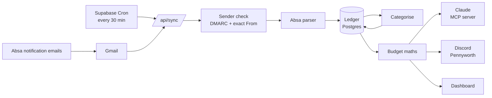

# tagmex

A personal budget that keeps itself. tagmex reads the notification emails your bank already sends
you, turns each one into a categorised transaction, and keeps a running budget that runs from one
payday to the next. You talk to it through **Claude**, it reports to **Discord** as Pennyworth (a
butler who keeps the books), and the same numbers are on a small **web dashboard**.

It is built for one person's Absa accounts, in South African rand, but the bank parsing is
pluggable.

## What it does

- **No bank login, no screen scraping.** Every Absa card swipe, debit order and transfer sends a
  "notifyme" email. tagmex reads those from Gmail (read-only) every 30 minutes.
- **Categorises for you, and learns.** Known merchants are filed automatically. Anything it
  doesn't recognise lands in a review queue; once you file a description, it remembers.
- **Budgets by pay cycle, not calendar month.** A cycle starts the day your salary lands and ends
  the day before the next one, so "how much can I still spend?" has a real answer.
- **Answers questions in plain language.** Ask Claude "where do I stand?", "what debit orders
  haven't gone off?" or "help me sort what's uncategorised", on desktop or your phone.
- **Tells you without being asked.** A daily digest, alerts at 80% and 100% of a budget, a
  heads-up when a debit order costs more than expected, and a note when your salary lands (or is
  late).

## How it works



1. **Sync.** Supabase Cron calls `/api/sync`. It fetches new emails from the bank's sender,
   keeps only those that passed DMARC for the bank's domain, and parses each into amount, account,
   merchant description and available balance. Every email is recorded once, keyed on its Gmail
   message id, so a retry never duplicates anything. Emails that fail to parse are kept and can be
   re-processed after a parser fix.
2. **Categorise.** Each transaction is tried against, in order: your learned rules (exact
   description and direction), built-in merchant rules (whole words, so `BP` never matches `BPA`),
   and transfer detection (an opposite amount on another of your accounts within 3 days). If none
   match it stays **uncategorised** and is posted to #needs-review.
3. **Learn.** When you file an uncategorised transaction (via Claude, a Discord dropdown or the
   dashboard), tagmex learns a rule for that description and applies it to the other uncategorised
   ones like it. Things already filed are never silently moved.
4. **Budget.** Numbers are computed on read from the ledger, never stored, so they are always
   consistent with the transactions.
5. **Report.** Claude reads it through the MCP server at `/api/mcp`; Discord gets posts as things
   happen and an hourly job sends the digest and alerts; the dashboard shows the same figures.

Every change, whether it comes from Claude, the dashboard or a Discord button, goes through one
shared set of commands with the same rules, so the three can never disagree.

## The budget

- **Cycles** run salary to salary. A cycle is named by the date the salary landed (e.g.
  `2026-10-30`) and labelled by the month it ends in ("November 2026"). The next payday is projected
  from your usual pay day, moved back for weekends and SA public holidays.
- **Budget items**: one per expense category, each `static` (debit orders, with an expected day),
  `dynamic` (groceries, fuel) or `irregular`.
- **Status**: a debit order that has gone off is **settled**; one still to come is **pending**.
  Spending categories are **on track**, **warning** from 80% and **over** from 100%.
- **Savings**: money moved into a savings category counts as **saved**, not spent.
- **Left** is income minus spent, saved and debit orders still to come: money not yet spoken for.
  **Discretionary left** takes overspending anywhere off that, and the **daily allowance** spreads
  it over the days to payday.
- **By hand**: cash spends can be added, and one transaction can be split across categories.
- Transfers between your own accounts count as neither income nor spending. Uncategorised
  transactions are left out of the numbers and reported alongside, so you know.

## Talking to it

**Claude** connects to `/api/mcp` as a custom connector (claude.ai → Settings → Connectors) and
signs in with Clerk. It gets read tools (`get_budget_overview` is the starting point, plus
transactions, categories, accounts, debit orders, trends and tips) and write tools (categorise,
re-categorise, budgets, categories, rules, exclusions, cash entries, splits, posting a status to
Discord). Writes that would touch many rows show a preview first and need your go-ahead. There are
also three ready-made prompts: `weekly_review`, `sort_inbox` and `plan_next_cycle`.

**Discord** has four channels:

| Channel | What Pennyworth posts there |
|---|---|
| #transactions | Each categorised transaction with its category's budget bar and days to payday |
| #needs-review | Each uncategorised transaction, with a category dropdown, Exclude, and Accept for Claude's suggestion |
| #budget | The daily digest, 80% / 100% alerts, debit orders that cost far more, salary landed or overdue |
| #system | Parse failures, sync or Gmail token failures, a sync that has gone quiet, heartbeat |

**The dashboard** at `/dashboard` (Clerk sign-in) has an overview, transactions, budget and
settings pages.

## Safety and privacy

- Gmail access is read-only, and only the bank's sender is read.
- Two allowlists: Clerk's sign-up restriction and the app's own `app_users` table. Every query is
  scoped to the signed-in user.
- Nothing is hard-deleted. Excluding a transaction is a soft delete, and splits can be undone.
- Transaction descriptions are treated as untrusted text: Claude is told to show them, never to
  follow them.
- Every MCP call is audited (kept 90 days) and limited to 60 a minute.

## Stack

Next.js 16 (App Router) on Vercel · Postgres on Supabase (with Supabase Cron) · Drizzle ORM · Zod
· Clerk (dashboard sign-in and MCP OAuth) · the MCP TypeScript SDK · Gmail API · Discord webhooks
and interactions.

## Running it

```bash
npm install
cp .env.example .env.local   # then fill it in
npm run dev
```

```bash
npm test             # unit tests (node:test via tsx)
npm run lint
npm run typecheck
```

CI runs lint, typecheck and tests on every pull request. Merging to `main` deploys to production,
and the production build applies any new database migrations itself.

Setting it up from scratch (Gmail, Clerk, Discord, connecting Claude) and day-to-day operations
live in [`.claude/skills/`](.claude/skills), written so that Claude Code can do them with you:

| Guide | For |
|---|---|
| [setup](.claude/skills/setup/SKILL.md) | First-time setup, environment variables, connecting Claude |
| [ops](.claude/skills/ops/SKILL.md) | Checking production, dry runs, re-processing, backfills, SQL checks |
| [migrations](.claude/skills/migrations/SKILL.md) | Changing the database schema safely |
| [mcp-tool](.claude/skills/mcp-tool/SKILL.md) | Adding or changing a Claude tool |

## Repository layout

| Where | What |
|---|---|
| `src/app/` | Pages (dashboard, sign-in, privacy), API routes (`api/sync`, `api/digest`, `api/mcp`, `api/discord`) and OAuth discovery |
| `src/features/` | Everything else, one folder per area: `bank-email`, `sync`, `transactions`, `categorisation`, `cycle`, `budget`, `commands`, `mcp`, `notifications`, … |
| `drizzle/` | SQL migrations |
| `scripts/` | One-off and setup scripts (Gmail auth, seed, backfill, allow a user) |
